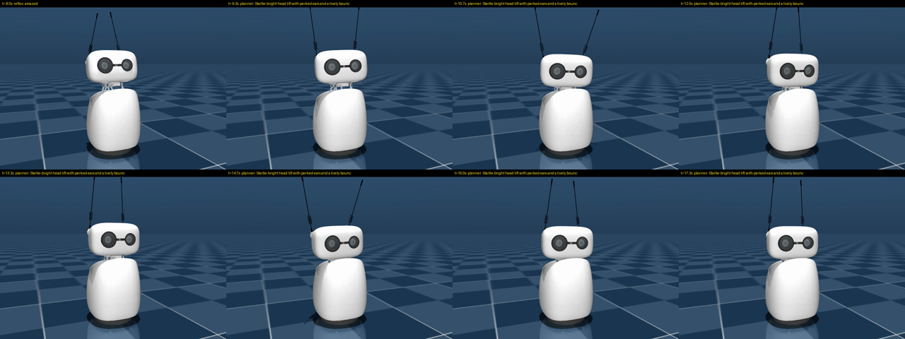

# Reachy-Motion

**跟 Reachy Mini 即時聊天，它會一邊講話、一邊隨著內容做動作。**

[English](README.md) · [知識庫（Obsidian wiki）](wiki/_Index.md)

Reachy-Motion 是 [Reachy Mini](https://github.com/pollen-robotics/reachy_mini) 機器人的即時語音聊天 app。
機器人說話時，回答的每個子句都會轉成一個帶有表情的手勢，動到頭、天線和身體，並且和聲音同步。
這些手勢疊在待機呼吸和隨語音擺頭之上。
動作的部分建立在 Binh Pham 的
[expressive motion harness](https://garden.binhph.am/articles/the-best-expressive-harness-for-robots) 之上，
使用他設計的動作 *recipe* 語言和 [`reachy-animation`](https://github.com/pham-tuan-binh/reachy-animation) 動畫器。



## 三種語音模式

| 模式 | 聲音 | 文字什麼時候到 | 回話延遲（實測） |
|---|---|---|---|
| `gpt-live` | OpenAI **GPT-Live-1**（全雙工） | 逐字稿，比聲音晚約 0.3 秒 | 幾乎即時 |
| `elevenlabs` | **ElevenLabs Agent** + **Eleven v4 Turbo** 聲音 | 每段音訊附字元時間軸，比播放早到 | 約 1–2 秒 |
| `taigi` | **台語**，完全本機：Breeze-ASR-26 → SARC 台語 LLM → KaedeTai GPT-SoVITS | 整句，TTS 之前就拿到 | 暖機後約 1.7 秒 |

在設定頁 `http://<host>:8042` 可以即時切換模式。頁面上也會顯示：
- 對話逐字稿
- 每個手勢和它的 recipe
- 即時的姿態預覽

## 手勢怎麼對準聲音

- **反射動作**：子句一出現「哈哈／哇／不行／對／？」這類關鍵詞，就零延遲做動作。
- **Planner**：用 LLM（預設 `gpt-5.4-nano`）替每個子句寫一段 recipe。
  例如「不行啦，那樣太危險了。」會得到 `go .25 e=40 p=4 | osc 1.2 y 12 .55 E=2.2 | go .35 e=25 p=3 E=1`。
- **預判反應**（GPT-Live）：GPT-Live 一講完就秒回，所以在你還在講的時候，就先規劃好它的第一個反應。
- 每個手勢都排在**喇叭的播放時鐘**上，和它對應的那句話同時開始。

細節請看 wiki：[架構](wiki/architecture/Architecture.md)、[播放時鐘](wiki/architecture/Playback%20Clock.md)、
[手勢導演](wiki/architecture/Gesture%20Director.md)、[延遲實測](wiki/findings/Latency%20Measurements.md)。

## 三種動作引擎

在 app 頁面的 **Motion** 切換（或設定 `REACHY_MOTION_MOTION_ENGINE`）：

| 引擎 | 誰寫動作腳本 | 誰把腳本變成動作 | 每句 |
|---|---|---|---|
| `recipe`（預設） | 雲端 LLM | 關鍵影格 + 雜訊細節 | ~1.2 秒 |
| `flow` | 雲端 LLM | Binh Pham 的 **flow-matching 生成模型**（學來的回彈、甩動、微動作） | ~1.4 秒 |
| `local` | Binh Pham 的**微調規劃模型**（0.8B，MLX） | flow-matching 生成模型 | **~0.75 秒**，不用雲端 |

機器人的 CM4 跑不動即時生成、規劃模型也需要 Apple Silicon，所以在同一個網路的 Mac 上，**用獨立的虛擬環境**（不要裝進系統或 conda base，它會升級 numpy 2、transformers 5）執行
`cd Reachy-Motion && uv venv && uv pip install -e ".[local]" && .venv/bin/reachy-motion-server`，機器人會用 mDNS 自動找到它。
app 頁面會顯示 **Mac motion server** 的狀態（找不到／關閉／載入中／運作中，含記憶體用量），並可以按 **Start／Stop**
載入或卸載模型。想讓它每次登入都在背景待命（不載入模型，按 Start 才載入），執行一次
`.venv/bin/reachy-motion-server --install-login-item`（使用者層級的 LaunchAgent，`--uninstall-login-item` 移除）。
沒有伺服器時，機器人維持 `recipe` 算法，不會用自己的 CPU 硬算。權重（Apache-2.0）第一次使用時從 Hugging Face 下載。

## 安裝與執行

```bash
git clone https://github.com/dAAAb/Reachy-Motion && cd Reachy-Motion
uv venv -p 3.12 && uv pip install -e .
cp .env.example .env        # 填入 OPENAI_API_KEY、ELEVENLABS_AGENT_ID…（.env 不會進 git）

reachy-motion --mode taigi --audio local     # 在 Mac 上跑，機器人走 Wi-Fi，用 Mac 的麥克風和喇叭
reachy-motion --mode gpt-live --no-robot     # 沒有機器人：在瀏覽器預覽動作
```

在機器人上，它是標準的 `ReachyMiniApp`，可以從 dashboard 啟動，會用機器人自己的麥克風和喇叭。

用筆電喇叭時，預設是**半雙工**：機器人講話時麥克風會靜音，避免它聽到自己的聲音。
想要隨時插話，請戴耳機並加上 `--no-half-duplex`。

### 台語模式

需要三個本機服務，都來自 AIRI NTU-VH2026 語音實驗室：
- Breeze-ASR-26（MLX）
- 跑 `SARC-Taigi-LLM-12b` 的 Ollama
- KaedeTai GPT-SoVITS

本 repo 不附任何權重或參考音檔。請見 [台語本機管線](wiki/voices/Taigi%20Local%20Pipeline.md)。

## 沒有機器人也能錄一段

```bash
python scripts/record_session.py --mode gpt-live --input question.wav --seconds 20 --out recordings/demo
```

用 WAV 檔當麥克風輸入，把回話的聲音、逐字稿和每一個姿態錄下來，再用 Reachy Mini 的 MuJoCo 模型渲染成 MP4 和 JSON 紀錄。

## 狀態

v0.1：三種模式都已經端到端跑通，並在模擬器中錄影，但還沒在實體機器人上驗收。

下一步：
- 實機驗收
- 把 Binh Pham 的微調 planner 和 flow-matching generator 移植到 Apple Silicon 本機
- 讓台語模式能直接在機器人上跑

詳見 [Backlog](wiki/Backlog.md)。

## 授權

Apache-2.0，見 [LICENSE](LICENSE) 與 [NOTICE](NOTICE)。
Recipe 語言與 planner 範例改編自 Binh Pham 的
[reachy-motion-generator](https://github.com/pham-tuan-binh/reachy-motion-generator)（Apache-2.0）。
